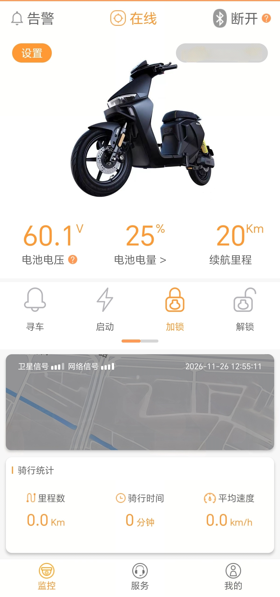

# 智能电动车管家 · Home Assistant 集成（HACS）

把「智能电动车管家」App（znapi.uqbike.com）的车辆接口接进 Home Assistant：一个开关同时控制启动与加锁，鞍座锁做成点动按钮，并给出电压、电流、电量、续航、当前位置和每日里程。



> 上图是「智能电动车管家」官方 App 的车辆控制界面。本项目不是官方客户端，而是把这款 App 背后的车辆接口（`znapi.uqbike.com`）逆向整理成了 Home Assistant 集成：App 里的启动/加锁、鞍座锁、寻车、电压电量、定位和每日里程，在这里都对应成 HA 的实体，界面可以拿来一一对照。

## 功能

- **一个开关管两件事**：开 = 启动（若车辆处于设防状态，会先自动解锁再启动）；关 = 加锁（断电设防）。
- **点动按钮**：鞍座开锁 / 寻车，按下即下发一次指令并等待车辆回执，不做状态保持。鞍座锁是手动机械锁，只需要一个开锁动作，所以没有上锁按钮。
- **传感器**：电压（V）、电流（A）、电量（%）、剩余续航（km）、今日里程、今日骑行时长、今日平均速度、当前位置地址。
- **定位**：设备追踪器直接给出 GPS 经纬度，可在 HA 地图上显示，地址、定位时间、GPS/GSM 信号作为属性。
- **状态**：在线、已设防、行车中 三个二进制传感器。
- **每日里程**：今日里程传感器附带近 7 天里程、当日分时数据，便于做统计卡片与自动化。
- 登录过期自动重新登录；账号密码失效会提示重新认证（reauth）。

## 安装

### 方式一：HACS 自定义仓库

1. HACS → 右上角菜单 → 自定义存储库（Custom repositories）。
2. 仓库地址填本项目地址，类别选 **Integration**。
3. 在 HACS 中搜索「智能电动车管家 / ZNDDC」安装，重启 Home Assistant。
4. 设置 → 设备与服务 → 添加集成 → 搜索「智能电动车管家」。

### 方式二：手动安装

把 `custom_components/znddc` 整个文件夹复制到 HA 配置目录的 `custom_components/` 下：

```
/config/custom_components/znddc/
├── __init__.py
├── api.py
├── binary_sensor.py
├── button.py
├── config_flow.py
├── const.py
├── coordinator.py
├── device_tracker.py
├── entity.py
├── manifest.json
├── sensor.py
├── strings.json
├── switch.py
└── translations/
```

重启 HA 后同样在「设备与服务」里添加集成。

> 仓库根目录同时带有 `hacs.json`，适合作为 HACS 自定义仓库；如果只想手动安装，只需要 `custom_components/znddc` 这个目录。

## 配置

添加集成时表单有三个必填项：

| 项目 | 说明 |
| --- | --- |
| 登录方式 | **手机号** 或 **邮箱**，决定接口参数 `loginType`（手机号=11，邮箱=12），不再靠正则猜 |
| 账号 | 手机号填 11 位数字；邮箱填完整地址（需含 `@` 和域名） |
| 密码 | 原 App 密码，结尾的中文句号会自动纠正为英文句点 |

车辆：账号绑定多辆车时会再弹出选择页，单车则直接添加。

可选项（集成页面「配置」）：

- **状态轮询间隔**：默认 60 秒，范围 30–600 秒。
- **反查中文地址**：关闭后不再调用 `map/getAdd.do`，省接口次数，只保留经纬度。

## 实体一览

| 实体 | 类型 | 说明 |
| --- | --- | --- |
| `switch.xxx_qi_dong` | 开关 | 开=启动（必要时先解锁），关=加锁断电 |
| `button.xxx_xun_che` | 按钮 | 寻车（`type=5`） |
| `button.xxx_an_zuo_kai_suo` | 按钮 | 鞍座开锁（`type=7`，点动，无上锁） |
| `button.xxx_shua_xin_zhuang_tai` | 按钮 | 立即刷新一次数据 |
| `sensor.xxx_dian_ya` | 传感器 | 电池总电压 V |
| `sensor.xxx_dian_liu` | 传感器 | 电池总电流 A |
| `sensor.xxx_dian_liang` | 传感器 | 电量 % |
| `sensor.xxx_sheng_yu_xu_hang` | 传感器 | 剩余续航 km |
| `sensor.xxx_jin_ri_li_cheng` | 传感器 | 今日里程 km（属性含近 7 天、分时） |
| `sensor.xxx_jin_ri_qi_xing_shi_chang` | 传感器 | 今日骑行时长 min |
| `sensor.xxx_jin_ri_ping_jun_su_du` | 传感器 | 今日平均速度 km/h |
| `sensor.xxx_dang_qian_wei_zhi` | 传感器 | 当前位置（中文地址） |
| `binary_sensor.xxx_zai_xian` | 二进制 | 车辆在线 |
| `binary_sensor.xxx_yi_she_fang` | 二进制 | 已加锁设防 |
| `binary_sensor.xxx_xing_che_zhong` | 二进制 | ACC 已上电 / 行车中 |
| `device_tracker.xxx_ding_wei` | 追踪器 | GPS 经纬度 |

同一辆车的所有实体归到一个设备下，`xxx` 是设备名（车辆昵称）。

## 控制逻辑

- 开关打开：读取当前状态，若 `lock=true` 且未上电 → 先发 `type=2`（解锁）并等待回执，再发 `type=3`（启动）。
- 开关关闭：发 `type=1`（加锁断电设防）。原 App 的「关闭」（`type=4`）在很多控制器上不生效，所以这里统一用加锁断电，和网页控制台的做法一致。
- 每次下发指令后会轮询 `machine/loop.do`（最多 10 次、间隔 0.7 秒）确认车辆回执，成功后立刻刷新状态，8 秒后再补一次以捕捉上报延迟。
- 命令之间串行执行，连点不会互相干扰。

## 自动化示例

```yaml
automation:
  - alias: 晚上回家自动加锁
    triggers:
      - trigger: time
        at: "23:00:00"
    actions:
      - action: switch.turn_off
        target:
          entity_id: switch.zhi_neng_dian_dong_che_qi_dong

  - alias: 出门前启动车辆
    triggers:
      - trigger: state
        entity_id: person.me
        to: "home"
    actions:
      - action: switch.turn_on
        target:
          entity_id: switch.zhi_neng_dian_dong_che_qi_dong
```

每日里程做统计卡片时，直接用 `sensor.*_jin_ri_li_cheng` 的 `last_7_days` 属性即可。

## 卡片示例

```yaml
type: entities
title: 小电驴
entities:
  - entity: switch.zhi_neng_dian_dong_che_qi_dong
  - entity: button.zhi_neng_dian_dong_che_xun_che
  - entity: button.zhi_neng_dian_dong_che_an_zuo_kai_suo
  - entity: sensor.zhi_neng_dian_dong_che_dian_ya
  - entity: sensor.zhi_neng_dian_dong_che_dian_liang
  - entity: sensor.zhi_neng_dian_dong_che_sheng_yu_xu_hang
  - entity: sensor.zhi_neng_dian_dong_che_jin_ri_li_cheng
  - entity: sensor.zhi_neng_dian_dong_che_dang_qian_wei_zhi
```

地图上直接加 `device_tracker.zhi_neng_dian_dong_che_ding_wei` 即可显示车辆位置。

## 作为 HACS 自定义仓库发布

HACS 通过 GitHub 仓库安装，步骤如下：

1. 把仓库根目录（含 `custom_components/znddc` 与 `hacs.json`）推到自己的 GitHub 公有仓库。
2. 打一个 tag 并发布 Release（例如 `v1.0.0`），HACS 会按 Release 版本安装。
3. 在 HACS → 自定义存储库中添加该仓库，类别选 Integration，然后安装。

只想快速用起来的话，直接用上面的「方式二：手动安装」即可，不需要 GitHub。

## 说明与限制

- 云端接口为 HTTP（`http://znapi.uqbike.com/`），全部请求由 HA 后端发起，不涉及浏览器跨域。
- 账号与原 App 共用，同一账号频繁登录可能被踢下线；集成只在 setup 或 token 失效（`code=-1002`）时登录。
- 车辆离线时状态接口仍会返回缓存数据，传感器数值可能偏旧，可用「在线」二进制传感器判断。
- 近 7 天里程每 30 分钟刷新一次（最多 7 次接口调用），今日里程每 5 分钟刷新；状态按配置间隔轮询。
- 部分车型没有 BMS 上报，此时电压/电流/电量会显示为不可用。
- 集成不写入 token 到配置条目，HA 重启后会重新登录一次。

## 目录结构

```
hacs_znddc/
├── custom_components/znddc/   # 集成本体
│   ├── brand/icon.png         # 本地品牌图标（256×256，透明底）
│   └── icon.png               # 兼容旧版 HA 的图标
├── hacs.json                  # HACS 元数据
└── README.md
```

## 版本

- 1.0.0：首个版本，包含合并式启动/加锁开关、鞍座点动按钮、寻车、状态与每日里程传感器、设备追踪。
